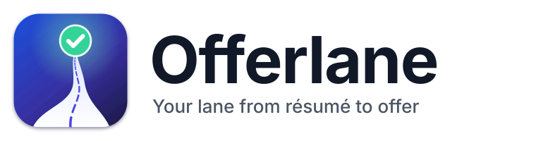
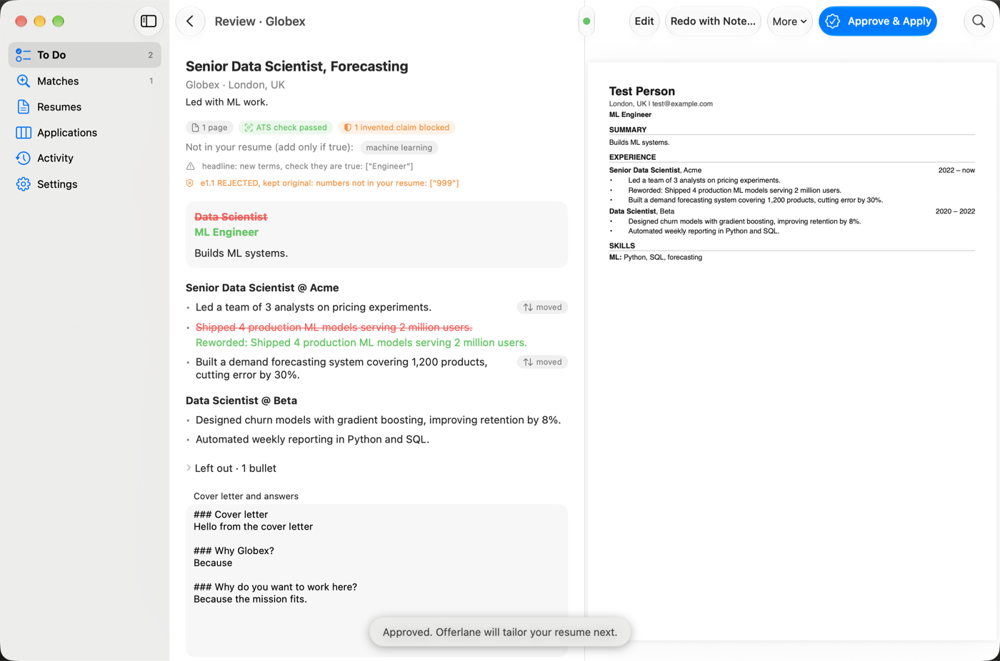
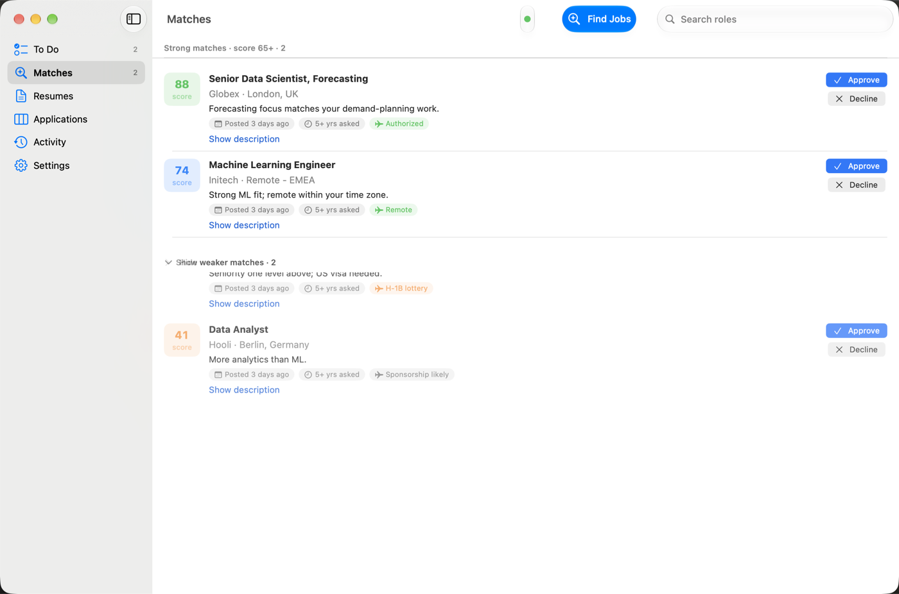
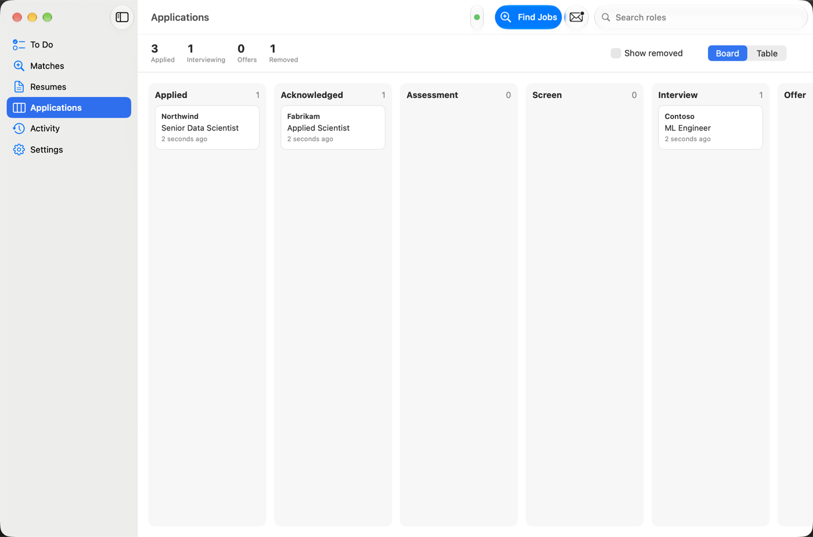
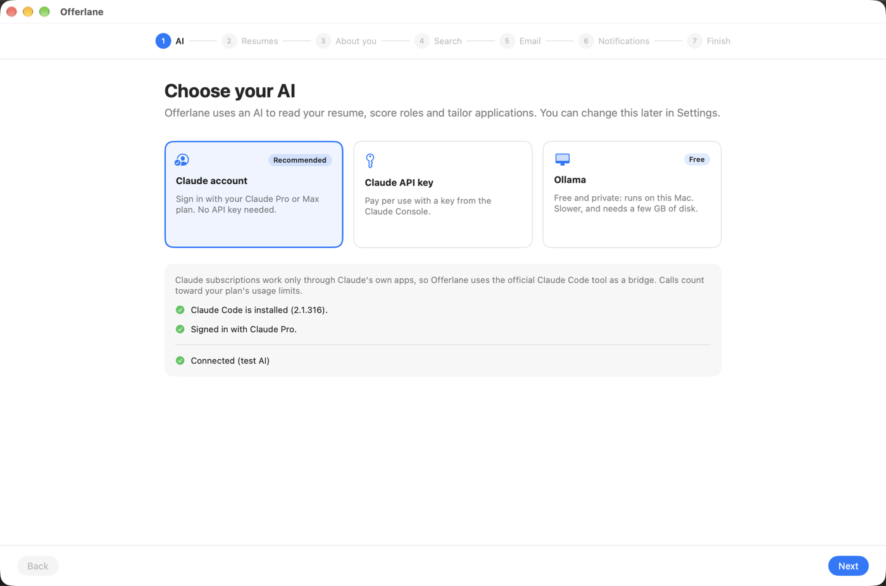
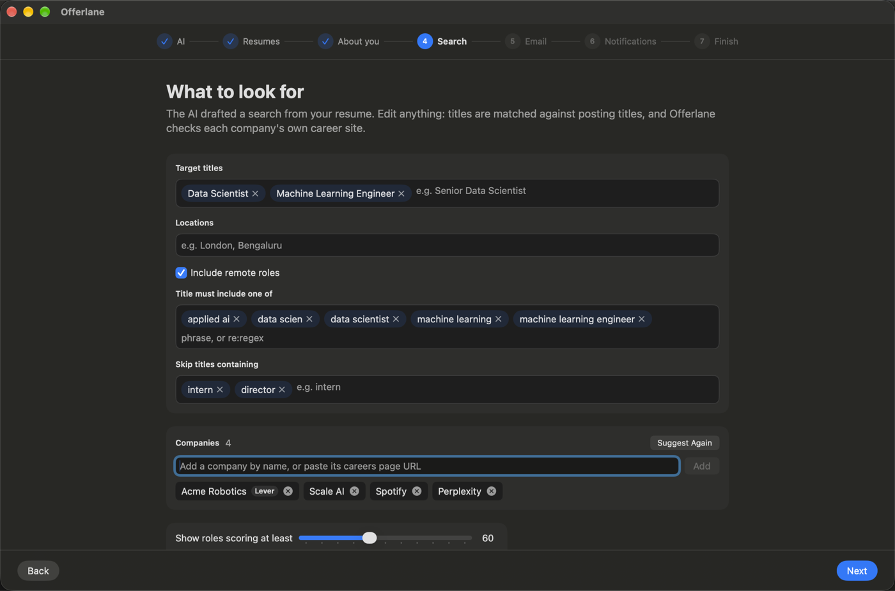

<p align="center">
  <picture>
    <source media="(prefers-color-scheme: dark)" srcset="Branding/offerlane-wordmark-dark.svg">
    
  </picture>
</p>

<p align="center">
  <b>Your lane from résumé to offer.</b><br>
  A native macOS app that finds roles on company career sites, tailors your résumé for each one,
  pre-fills the application and stops for you to click Submit. You approve every step.
</p>

<p align="center">
  
  
  
</p>

<p align="center"></p>

## What it does

1. **Find Jobs** checks your target companies' own career sites: Greenhouse, Lever, Ashby, Workable, SmartRecruiters and Workday. A free local pre-score narrows the results, then **one batched AI call** scores the best ~25 and picks which résumé version fits.
2. **You approve** the roles worth applying to. Declined roles are fingerprinted and never come back.
3. Offerlane **tailors your résumé** for each approved role in one AI call. It reorders and rephrases your own bullets, and drafts a cover letter and screening answers.
4. **You review every change** in a side-by-side diff with a live PDF preview. A guard **enforced in code** rejects any rewrite that invents a number and flags new tool or company names.
5. Offerlane **fills the application** in its own browser window at a human pace: Workday's multi-page flow, uploads, dropdowns, screening questions. Before creating a career-site account it asks you, and saves the password in your Keychain. It **stops on the page with Submit**.
6. **You click Submit.** Replies in your inbox (via IMAP) move each application through acknowledged, assessment, interview and offer. Rejections are hidden but counted.

| Matches | Applications |
|---|---|
|  |  |
| **Setup: choose your AI** | **Search, drafted by the AI** |
|  |  |

## Highlights
- **Bring your own AI**: a Claude Pro/Max subscription (through the official Claude Code CLI), a Claude API key, or **Ollama** (free, private, on your Mac). The AI layer is provider-agnostic, with a deterministic fake for tests.
- **Low token use**: one batched scoring call per search and one call per tailored résumé, with the static context prompt-cached.
- **Your LaTeX design stays yours**: LaTeX résumés are compiled by a bundled [tectonic](https://tectonic-typesetting.github.io) with only bullet text swapped. Other résumés use a clean, ATS-friendly template. A page-fit loop and an ATS text check run on every PDF.
- **Work-authorization aware**: postings are tagged by where you can work without sponsorship, the JD's sponsorship wording and public sponsor registers, and screening questions are answered accordingly.
- **Native and private**: SwiftUI, SQLite (GRDB) and Keychain. No telemetry; everything stays on your Mac.

## Safety by design
- Offerlane **never clicks a final Submit**, never solves or bypasses CAPTCHAs, never hides that it is automation, and never logs in to LinkedIn.
- Every state change goes through an explicit state machine. Approval gates can't be skipped: nothing is tailored, applied for or created without you.
- Career-site accounts are created only after you approve that company, and passwords go to Keychain before the Create button is clicked.
- Respect each site's terms of use. Offerlane is a personal assistant for your own applications, not a bulk tool.

## Privacy
- Your data lives in `~/Library/Application Support/Offerlane/`. Secrets (API key, email app password, career-site passwords) live **only in Keychain**.
- What leaves your Mac: résumé text and job descriptions go to the AI provider you chose; form answers go to the career sites you apply to; nothing else.
- Settings has **Export Everything** and **Delete All My Data**. Logs redact emails, phone numbers and keys.

## Install
Download `Offerlane-<version>.dmg` (drag to Applications) or `Offerlane-<version>.pkg` (installer) from [Releases](../../releases), and check it against `SHA256SUMS.txt`.

Builds aren't notarized yet, so macOS asks once: right-click Offerlane → **Open** → **Open**. For the .pkg, use **System Settings → Privacy & Security → Open Anyway**.

Then see the [user guide](docs/USER_GUIDE.md).

## Build from source
Requirements: macOS 14+, Xcode 16+, [XcodeGen](https://github.com/yonaskolb/XcodeGen) (`brew install xcodegen`).

```bash
scripts/fetch-tectonic.sh     # vendors tectonic 0.17.0 (pinned SHA-256) and warms its package cache
scripts/build.sh              # Debug build → build/DerivedData/Build/Products/Debug/Offerlane.app
scripts/test.sh core          # unit + integration tests (no network, deterministic fake AI)
scripts/test.sh ui            # UI tests
scripts/test.sh apply         # apply engine against bundled mock career sites (runs inside the app)
scripts/package.sh            # universal Release → dist/Offerlane-<version>.dmg + .pkg + SHA256SUMS.txt
```
To sign and notarize, set `DEVELOPER_ID`, `INSTALLER_ID` and `NOTARY_PROFILE` (see `scripts/package.sh`).

More detail: [architecture](docs/ARCHITECTURE.md) · [testing](docs/TESTING.md) · [contributing](CONTRIBUTING.md) · [security](SECURITY.md).

## License
[MIT](LICENSE) © 2026 Somil Manke. Offerlane isn't affiliated with Anthropic, Ollama, Workday, Greenhouse, Lever, Ashby, Workable or SmartRecruiters; names are used only to describe compatibility. Bundled tectonic is MIT-licensed.
