

  <picture>
    <source media="(prefers-color-scheme: dark)" srcset="Branding/offerlane-wordmark-dark.svg">
    
  </picture>

  <b>Your lane from résumé to offer.</b> 
  A Mac app that finds roles on company career sites, tailors your résumé for each one, fills in the application,
  and stops so <b>you</b> click Submit. You approve every step.

  
  
  

  <picture>
    <source media="(prefers-color-scheme: dark)" srcset="docs/screenshots/readme-discover-dark.png">
    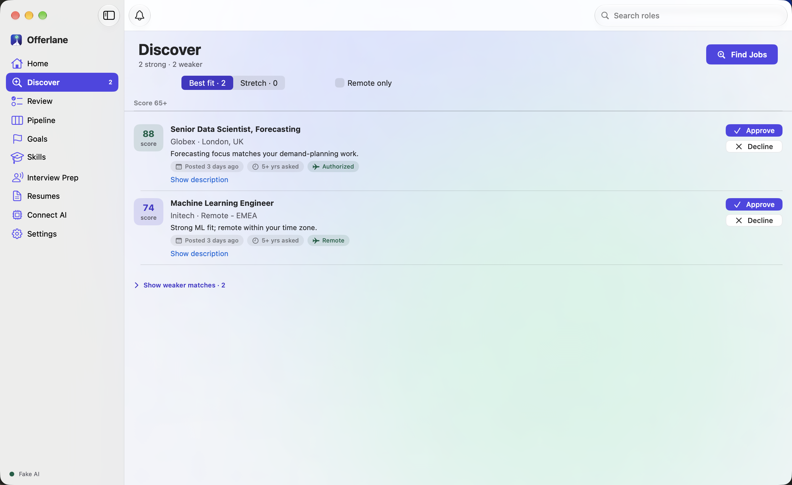
  </picture>

## How it works

Offerlane covers the whole job search: set goals, find roles, close skill gaps, apply, prepare and track. You decide at every 👤 step.

```mermaid
flowchart LR
    S["🔌 Connect an AI<br/>one-click sign-in,<br/>free or paid"] --> A["🔎 Find Jobs<br/>career sites + remote feed;<br/>your watchlist ranks first"]
    A --> B["Free local pre-score<br/>title, skills, location,<br/>seniority, visa rules"]
    B --> C["🤖 AI scores the best roles<br/>in one batched call"]
    C --> D{"👤 Approve<br/>or decline"}
    D -- declined --> X["Never shown again"]
    D -- approved --> E["🤖 Tailors your résumé<br/>from your own bullets;<br/>invented numbers blocked"]
    E --> F{"👤 Review<br/>every change"}
    F -- redo / edit --> E
    F -- approve --> G["🖥️ Fills the form<br/>and stops at Submit"]
    G --> H["👤 You click Submit"]
    H --> I["📬 Pipeline<br/>email replies move cards;<br/>insights by résumé version"]
    I --> J["🎤 Interview prep<br/>STAR stories from<br/>your real résumé"]
    J --> K["💼 Offers<br/>compare and negotiate"]
    A -. postings .-> L["📈 Skill gaps<br/>what employers ask for,<br/>with the postings behind it"]
    L --> M["🎯 Goals and learning plan<br/>verified links only"]
    M -. new targets .-> A
```

Nothing is tailored, applied for or created without your say-so. Offerlane never presses Submit, never solves CAPTCHAs and never logs in to LinkedIn.

## Get started in four steps

| 1. Sign in | 2. Connect an AI | 3. Add your résumé | 4. Find jobs |
|---|---|---|---|
| 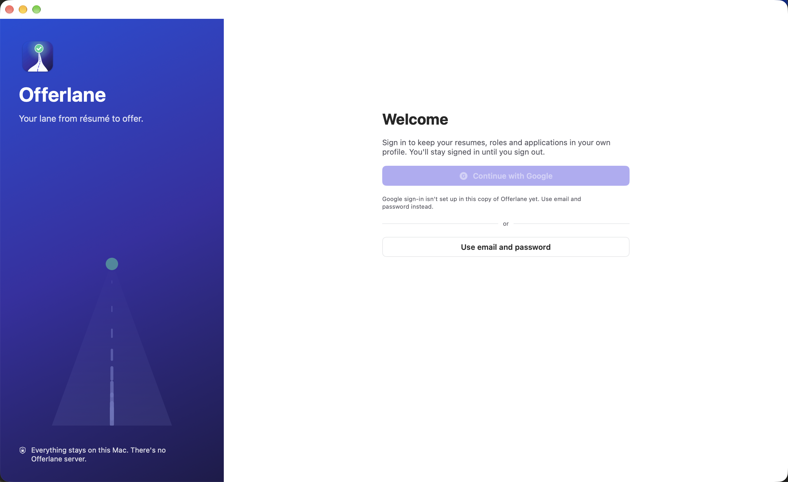 |  | 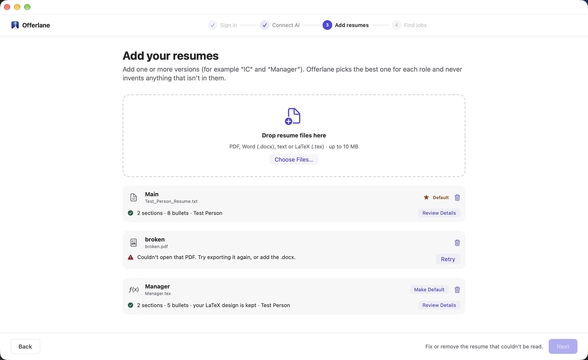 | 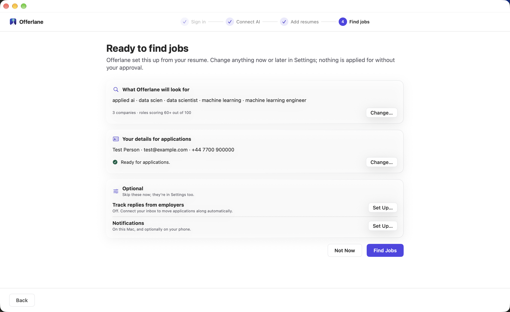 |
| Email and password; Touch ID optional | **Sign in with OpenRouter** (no key to copy), or Ollama, Gemini, Groq, Cloudflare, a Claude API key or your own endpoint | PDF, Word, text or LaTeX; several versions welcome | Titles and companies are drafted from your résumé; change anything later |

## What's new in 0.3.0
- **Connect any AI in one click**: **Sign in with OpenRouter** for free models, or paid ones once you add credit. Or connect Ollama, Gemini, Groq, Cloudflare, a Claude API key or your own endpoint. Add backups that take over when the first AI is down.
- **Wider search**: your company list boosts matches instead of limiting them.
- **Skill gaps and learning plans** based on real postings and verified links.
- **Career tools**: goals and paths, interview prep, résumé health and ATS checks, insights, networking drafts, offer comparison and market trends.
- **Clearer errors**: every failure says what happened and what to do.

Earlier releases: [release notes](docs/RELEASE_NOTES.md).

## A tour of the app

| | |
|---|---|
| 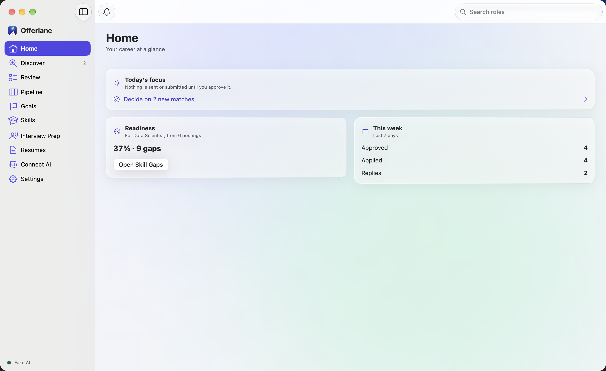 **Home.** Today's focus, your readiness for the role you want, and this week's numbers. |  **Review every change.** Your original in red, the tailored text in green, with a live PDF preview. Claims not in your résumé are blocked. |
| 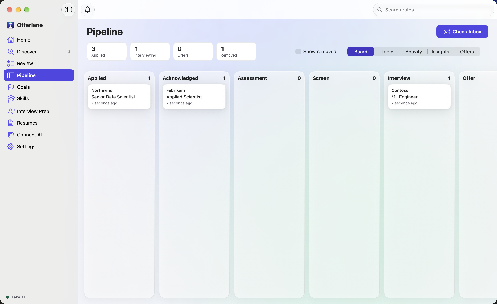 **Pipeline.** Every application on one board. Replies in your inbox move cards along by themselves. | 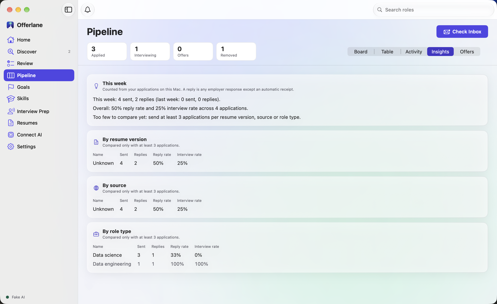 **Insights.** Reply and interview rates by résumé version, source and role type. |
| 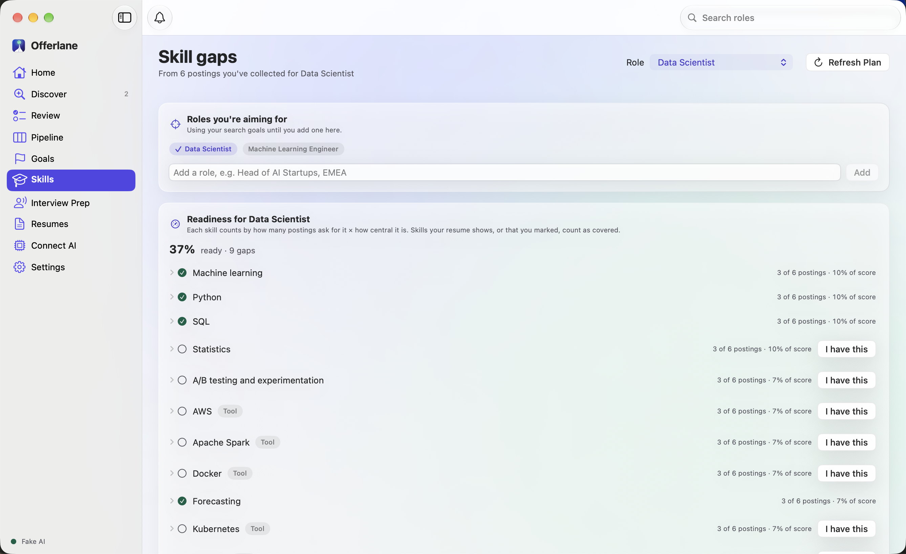 **Skill gaps.** Which skills the roles you want ask for, counted from real postings, and a learning plan from verified links. | 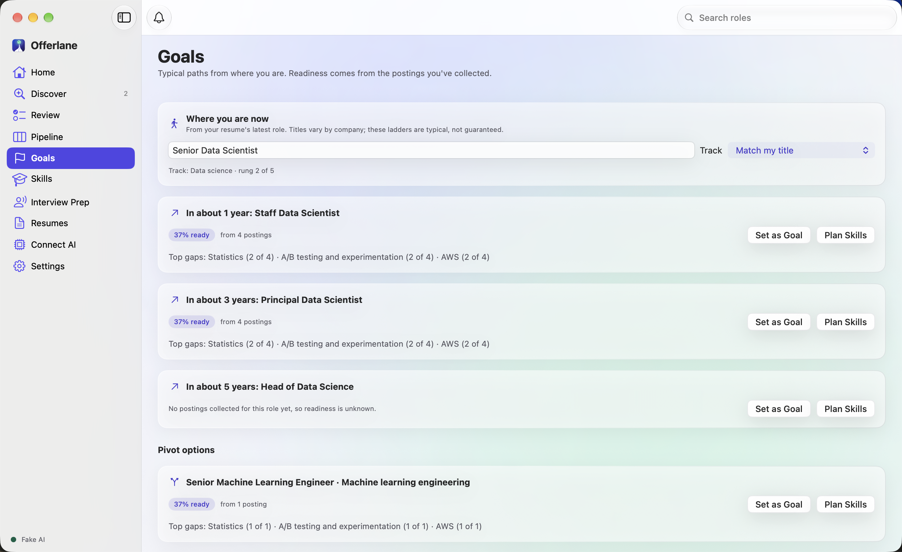 **Goals.** One-, three- and five-year paths and pivot options, with readiness for each. |
| 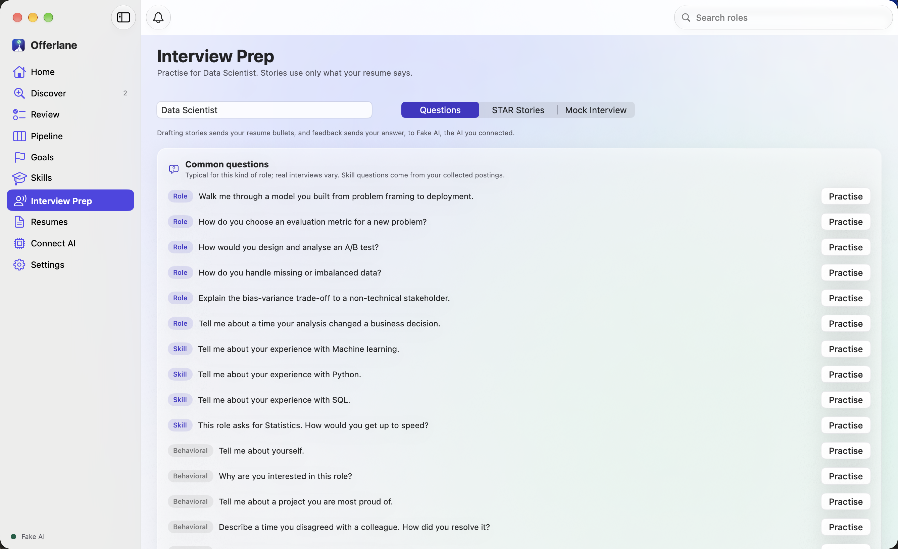 **Interview prep.** Questions for the role, a STAR story bank built only from your résumé, and a mock interviewer. | 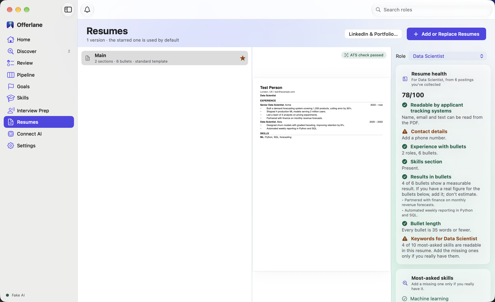 **Résumés.** Several versions, a résumé health and ATS check per role, and LinkedIn and portfolio tips. |
| 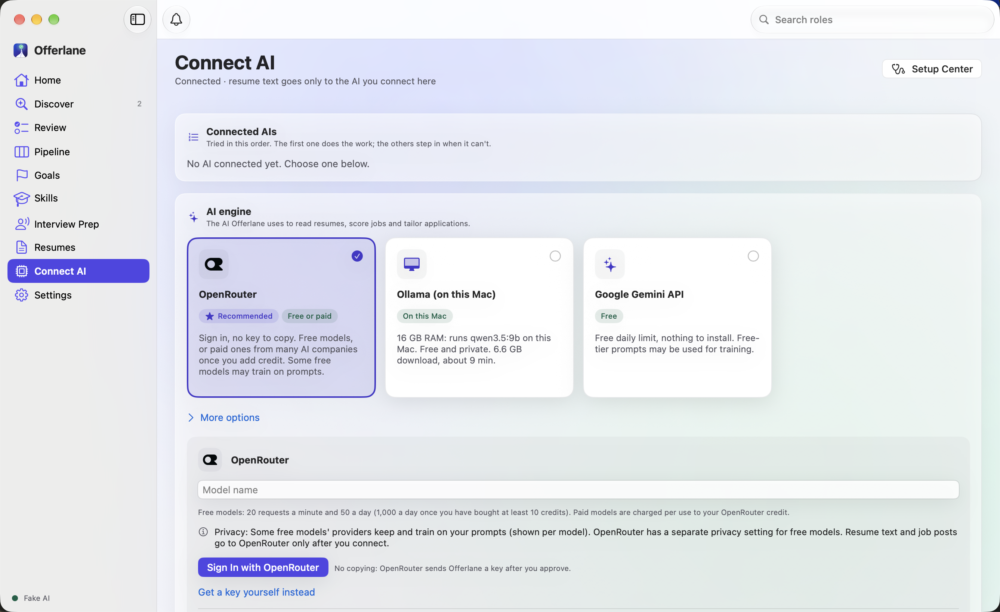 **Connect AI.** Sign in once, or pick a provider. Each option says what it does with your data before you connect. | 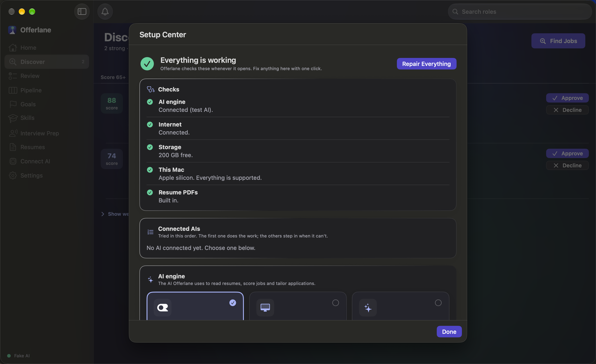 **Setup Center.** Checks your AI, internet, storage and Mac, and fixes problems with one click. |

## Install
1. Download **Offerlane-0.3.0.dmg** (or the .pkg) from [Releases](../../releases), and check it against `SHA256SUMS.txt` if you like.
2. Open the DMG and drag **Offerlane** into **Applications**.
3. The first time only: Offerlane isn't notarized by Apple yet, so macOS says it can't check it. Control-click Offerlane in Applications and choose **Open**, then **Open** again. On macOS 15 or later, go to **System Settings → Privacy & Security** and click **Open Anyway**. After that it opens normally.
4. Open Offerlane and follow the four steps above. It takes about ten minutes.

Requires macOS 14 (Sonoma) or later, on Apple silicon or Intel. There's nothing else to install by hand: the Setup Center handles the AI.

## Choose your AI
Offerlane suggests three options for your Mac. The easiest is **Sign in with OpenRouter**: one click, no key to copy, and it covers free models plus paid models from many AI companies once you add credit. The other options connect to one provider directly.

| | Cost | What happens to your data |
|---|---|---|
| **Ollama** | Free; runs on your Mac | Everything stays on your Mac. Slower, and needs a few GB of disk |
| **Google Gemini** | Free key; limits shown in Google AI Studio | On the free tier Google may use your prompts to improve its products, and human reviewers may read them. Not offered in the EEA, Switzerland or the UK |
| **OpenRouter** (sign in) | Free models: 20 requests a minute, 50 a day. Paid models: pay per use with OpenRouter credit | Some free models' providers keep and train on prompts; OpenRouter shows this per model |
| **Groq** | Free plan, no card; limits per model shown in the Groq console | Doesn't train on your inputs or keep inference data by default (abuse logs up to 30 days) |
| **Cloudflare Workers AI** | Free key; 10,000 Neurons a day | Doesn't train on your content or keep standard requests |
| **Claude API key** | Pay per use: about $0.001 per Find Jobs run, about $0.03 per tailored résumé | Anthropic doesn't train on paid API content |
| **Your own endpoint** | Depends on the endpoint | Goes to the endpoint you enter; check its terms |

The app shows the same note before you connect, and **Help → What does each AI do with my data?** lists it for every option. Terms and limits change, so the app keeps them in an updatable list. This table was checked on 2026-11-11.

## Privacy
Everything stays on your Mac, and passwords and keys stay in your Keychain. Only résumé text and job descriptions go to the AI you choose, and only form answers go to the career sites you apply to. There's no telemetry. Read the [privacy policy](docs/PRIVACY.md).

## Other platforms
Offerlane is built and tested for the Mac only. **Windows, Android and iOS are experimental and not built yet**: there's no installer or app for them, only a plan.

## Help and feedback
- **In the app:** Help → Offerlane Help (⌘?).
- **Online:** the [user guide](docs/USER_GUIDE.md).
- **Bugs:** [open an issue](../../issues/new/choose) and attach a report from Help → Send Diagnostics….
- **Security issues:** see [SECURITY.md](SECURITY.md).

## License
See [LICENSE](LICENSE).
