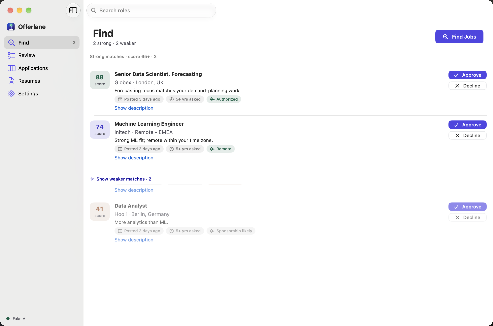
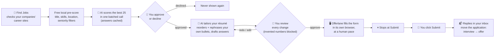
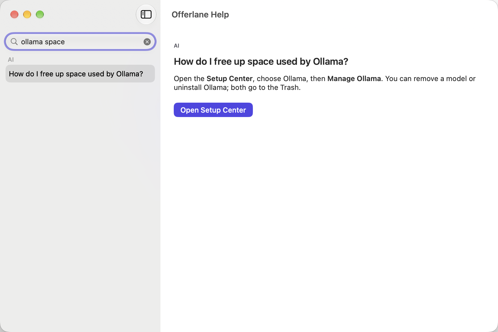

  <picture>
    <source media="(prefers-color-scheme: dark)" srcset="Branding/offerlane-wordmark-dark.svg">
    
  </picture>

  <b>Your lane from résumé to offer.</b> 
  A Mac app that finds roles on company career sites, tailors your résumé for each one, fills in the application,
  and stops so <b>you</b> click Submit. You approve every step.

  
  
  

## How it works

Nothing is tailored, applied for or created without your say-so. Offerlane never presses Submit, never solves CAPTCHAs and never logs in to LinkedIn.

## Get started in four steps

| 1. Sign in | 2. Connect an AI | 3. Add your résumé | 4. Find jobs |
|---|---|---|---|
|  |  |  |  |
| Email and password; Touch ID optional (Continue with Google is coming) | Claude account, Claude API key, or free local Ollama | PDF, Word, text or LaTeX; several versions welcome | Titles and companies are drafted from your résumé; change anything later |

## What's new in 0.2.0
- **A fresh design**: calmer layout, full dark mode, faster screens, and a short tour on first launch.
- **Profiles that stay signed in**:
  - email and password, with optional Touch ID (Continue with Google is built in and will be switched on in a later release);
  - several people can share one Mac;
  - your 0.1 data is brought across, with a backup made first.
- **Setup Center**:
  - installs Claude Code or Ollama for you, checking each download's checksum and publisher signature before it runs;
  - a health dot shows what needs attention, and **Repair Everything** fixes it in one click.
- **Help in the app** (⌘?): searchable answers, plus **Send Diagnostics**, a report with personal details removed that you see in full before sharing.
- **Lower AI costs**: answers are cached locally, a per-run limit stops spending, and a live meter shows usage.
- **Accessibility**: VoiceOver labels, full keyboard use, 4.5:1 contrast everywhere, and Reduce Motion respected.
- **Security review**:
  - saved career-site passwords are only typed into their own site;
  - email verification links are checked before opening;
  - shipped builds are hardened, with no special permissions.
- **Gmail (preview)**: read-only, for invited testers. IMAP stays the default.

## A closer look

| | |
|---|---|
|  **Review every change.** Your original in red, the tailored text in green, with a live PDF preview. |  **Track every application.** Email replies move cards along by themselves. |
|  **Setup Center.** Checks your AI, internet, storage and Mac, and fixes problems with one click. |  **Help built in.** Search answers, replay the tour, or create a diagnostics report. |

## Install
1. Download **Offerlane-0.2.0.dmg** (or the .pkg) from [Releases](../../releases), and check it against `SHA256SUMS.txt` if you like.
2. Open the DMG and drag **Offerlane** into **Applications**.
3. Open Offerlane and follow the four steps above. It takes about five minutes.

Requires macOS 14 (Sonoma) or later, on Apple silicon or Intel. There's nothing else to install by hand: the Setup Center handles the AI.

## Choose your AI
| | Cost | Notes |
|---|---|---|
| **Claude account** (recommended) | Your Claude Pro or Max plan | Uses the official Claude Code tool, installed and verified for you |
| **Claude API key** | Pay per use: about $0.001 per Find Jobs run, about $0.03 per tailored résumé | Daily usage in Settings; per-run limit |
| **Ollama** | Free; runs on your Mac | Slower; needs a few GB of disk; the model is picked for your Mac's memory |

## Privacy
Everything stays on your Mac, and passwords and keys stay in your Keychain. Only résumé text and job descriptions go to the AI you choose, and only form answers go to the career sites you apply to. There's no telemetry. Read the [privacy policy](docs/PRIVACY.md).

## Help and feedback
- **In the app:** Help → Offerlane Help (⌘?).
- **Online:** the [user guide](docs/USER_GUIDE.md).
- **Bugs:** [open an issue](../../issues/new/choose) and attach a report from Help → Send Diagnostics….
- **Security issues:** see [SECURITY.md](SECURITY.md).

## License
See [LICENSE](LICENSE).
